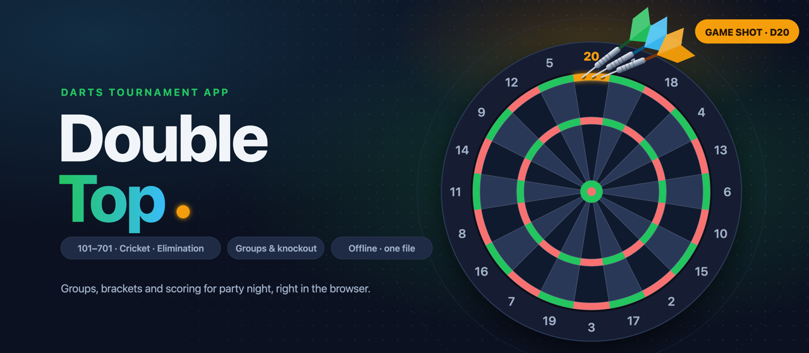

# 🎯 Double Top

A darts tournament app for a party night, in a single HTML file. Open `index.html` in a browser. There's nothing to install or build, and it doesn't need a server or an internet connection.

## Features

- **Players and groups:** add players one by one or as a comma-separated list. Groups of 3 can be drawn at random or set by hand, and late arrivals can join in new groups while the group stage is running.
- **Group stage:** each group plays one game together, throwing in turn. The finishing order is the group ranking, and the top 1 or 2 of each group go through.
- **Knockout:** either a classic 1 vs 1 bracket with byes, or custom rounds with any number of games per round, players per game and players going through (for example 3 games of 2, then a final of 3).
- **Games:** 101 to 701 (straight or double out), Cricket (standard or cut-throat), and Elimination 301, where landing on another player's score sends them back to 0. The game can be changed per match before the first dart.
- **Scoring:** enter dart by dart or as a visit total. Busts are detected, checkouts are suggested, and any throw can be undone. Cricket uses an animated scoreboard that doubles as the keypad.
- **Stats:** 3-dart average, MPR, 180s, 140+, highest checkout and legs won.
- **Show:** a win animation with confetti, a champion screen, and sounds for a miss, an overthrow, a knock-back and a win. Each sound and animation can be switched off.
- **Phones:** the layout fits a phone screen, with a bottom tab bar and a keypad that fits on screen without scrolling. It can be added to the home screen, and it keeps the screen awake during a match.

## Usage

1. Open `index.html`. For phones, host it somewhere with an `https://` address (for example GitHub Pages), because iOS doesn't run a local file like this properly.
2. **Players & rules:** add the players and pick the game.
3. **Groups:** draw the groups, then press **Start tournament**.
4. **Group stage:** tap a game to score it. When all groups are done, choose the knockout format and draw it.
5. **Bracket:** play through to the champion.

Everything is saved automatically in the browser's local storage on that one device. Use one device as the scoreboard, or move the data with **Export / Import backup** on the first tab.

## Repository

| File | Purpose |
| --- | --- |
| `index.html` | The whole app: HTML, CSS, JavaScript, with the sounds embedded as base64 |

Each version raises `APP_VERSION` in `index.html` (it's shown in the header) and is committed as its own commit.

## Deployment

The app is hosted at [doubletop.jonas-miederer.de](https://doubletop.jonas-miederer.de). Pushing to `main` triggers the GitHub Action in [.github/workflows/deploy.yml](.github/workflows/deploy.yml), which:

1. Syncs the static files (`index.html`) to the `doubletop.jonas-miederer.de` S3 bucket in region `eu-central-1`, excluding repo and meta files (`.git`, `.github`, `README.md`, `.gitignore`, `.DS_Store`), the README image (`*.png`), and the sound source files (`*.mp4`, `*.ogg`, which are embedded in `index.html`).
2. Looks up the CloudFront distribution by its `doubletop.jonas-miederer.de` alias (so the distribution id is never hard-wired) and invalidates `/*`.

There is no build step. The S3 bucket and CloudFront distribution are provisioned by the separate [jonas-miederer.infra](https://github.com/jonasmiederer/jonas-miederer.infra) repository.

### Required GitHub secrets

- `AWS_ACCESS_KEY_ID`
- `AWS_SECRET_ACCESS_KEY`
